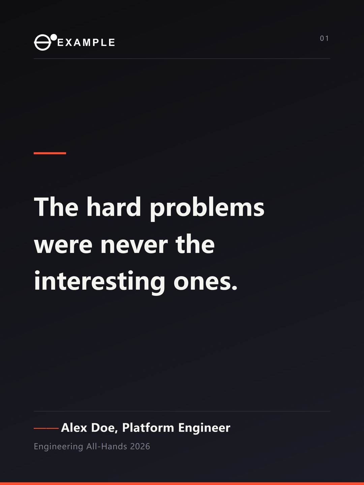
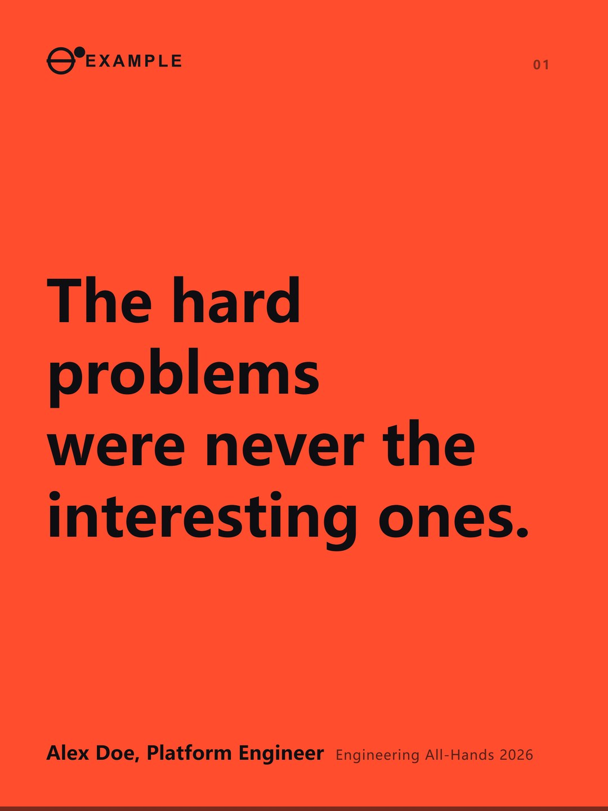
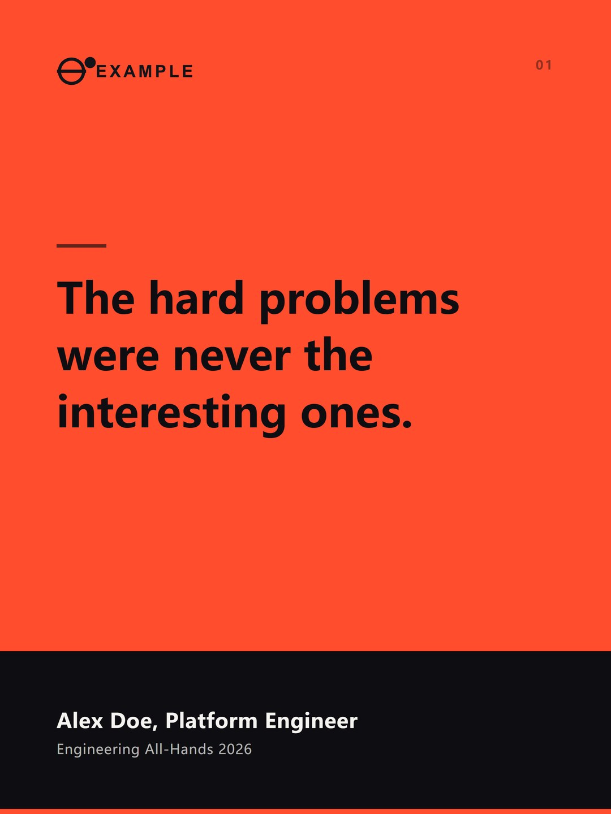
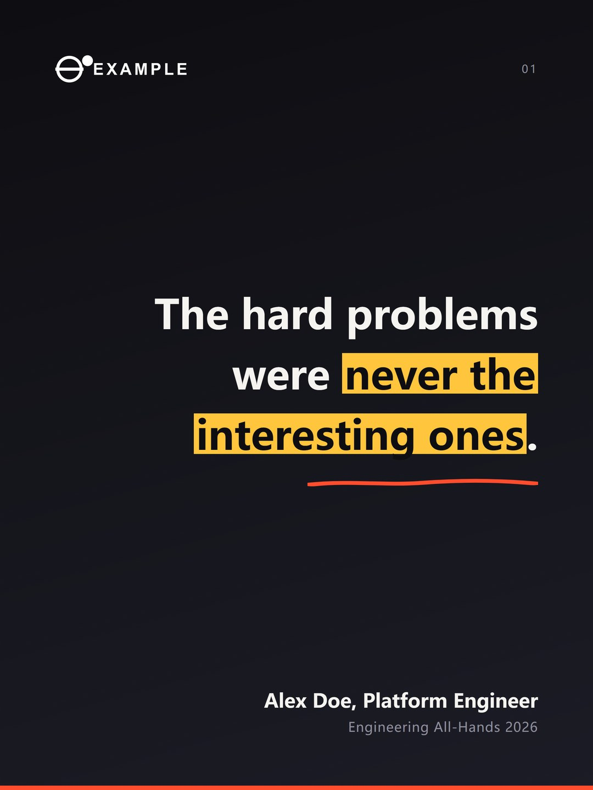
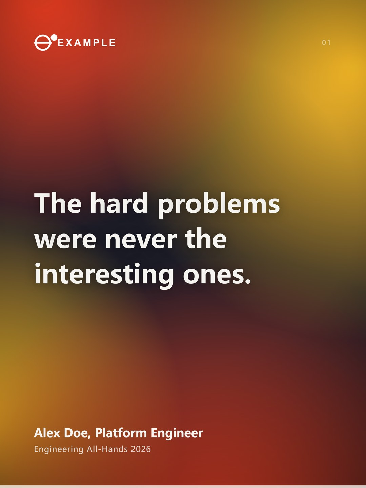
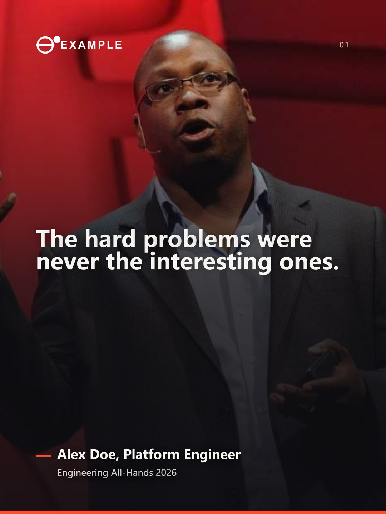
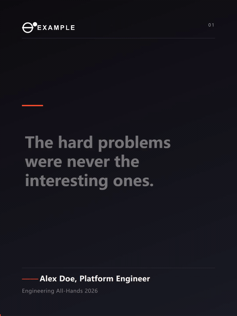
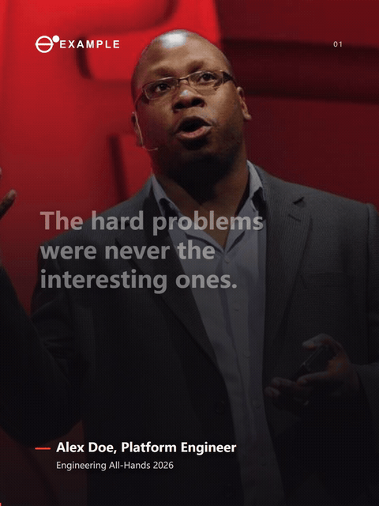

# quote-card

品牌/公关实用技能之制作quote card。
把创始团队在公开场合的演讲切片转化为贴合品牌叙事的quote card：支持输入自定义品牌视觉、logo、演讲照片等品牌资产，共有静态卡片和动态卡片两种输出模式，6种样式可选，动态卡片输出结果为演讲音频+实时滚动字幕。

---

## About

品牌金句（或一段音频）→ 一份 job 文件 → 出图、出片。

中间那一步是"描述这张卡长什么样的 JSON"。**用 agent 的话它替你写，用命令行的话你自己写**
（见下面的「使用方法」）。

- **输入** — 一句 quote（静态图），或一段音频 + 字幕时间轴（视频）
- **输出** — PNG 静态卡，MP4 竖版短视频
- **画幅** — 3:4（1080×1440，竖版默认）/ 1:1（1080×1080）/ 9:16（1080×1920）
- **模板** — 6 个：`editorial` `boldblock` `split` `marker` `gradient` `photoframe`

三件事值得先知道：

- **全本地跑。** Playwright 渲染、ffmpeg 合成、faster-whisper 出时间轴。**没有云端 API，没有账号，没有配额。**
- **静态和视频是同一套模板。** 模板只负责画，动效在 `runtime.js` 里 —— 六个静态模板就是六个视频模板。
- **品牌是"接进来"的一层。** 配色、字体、logo、底图都在 theme / job 里，代码本身不带任何人的品牌色。

### 样张

六个模板，同一句话：

<table>
  <tr>
    <td width="33%"></td>
    <td width="33%"></td>
    <td width="33%"></td>
  </tr>
  <tr>
    <td align="center"><b>editorial</b><br>杂志排版，发布会金句</td>
    <td align="center"><b>boldblock</b><br>整块主色，短句锐评</td>
    <td align="center"><b>split</b><br>上色块引文，下素底署名</td>
  </tr>
  <tr>
    <td width="33%"></td>
    <td width="33%"></td>
    <td width="33%"></td>
  </tr>
  <tr>
    <td align="center"><b>marker</b><br>关键词荧光笔，最像"截图会想存"</td>
    <td align="center"><b>gradient</b><br>柔和网格渐变，现代感</td>
    <td align="center"><b>photoframe</b><br>放自己的图，压字</td>
  </tr>
</table>

视频是同一批模板动起来的样子 —— 字幕跟着语音逐句上屏，当前句高亮，念过的变淡：

<table>
  <tr>
    <td width="50%"></td>
    <td width="50%"></td>
  </tr>
  <tr>
    <td align="center"><b>editorial</b>（<a href="docs/gallery/editorial.mp4">看 mp4</a>）</td>
    <td align="center"><b>photoframe</b>（<a href="docs/gallery/photoframe.mp4">看 mp4</a>）</td>
  </tr>
</table>

> 样张里的文字、署名、logo、底图都是占位内容（`assets/demo/`），只有 photoframe 的底图是一张真人演讲照 —— **仅做示意**，换成自己的照片请看 [License](#license)。

---

## 如何安装

**需要 Python 3.9+**，然后：

```bash
git clone https://github.com/Audrey-Zhou96/quote-card.git
cd quote-card
pip install -r requirements.txt
playwright install chromium      # 第一次要下 Chromium，约 150MB
```

`ffmpeg` 不是 pip 包，是系统里的一个程序，得单独装：

| 系统 | 命令 |
|---|---|
| Windows | `winget install Gyan.FFmpeg`，或从 [ffmpeg.org/download.html](https://ffmpeg.org/download.html) 下 |
| macOS | `brew install ffmpeg` |
| Linux | `sudo apt install ffmpeg` |

装完自检一次，**缺什么会一行一行指出来**：

```bash
python build.py doctor
```

```
quote-card doctor

  ok        ffmpeg   /usr/local/bin/ffmpeg
  ok        ffprobe  /usr/local/bin/ffprobe
  ok        playwright chromium 151.0.7922.34   (needed for every render)
  ok        faster-whisper 1.2.1   (needed for video)
  ok        pillow 12.3.0   (needed for every render)
  WARN      fonts/ has no font file   (themes fall back to the next family in the stack)

  static cards need only the browser. videos need ffmpeg + whisper.
```

> 只想出静态图的话，浏览器 + Pillow 就够了，ffmpeg 和 whisper 都可以不装。
>
> 想把它当 Claude Code skill 用，见 [SKILL.md](SKILL.md)。

---

## 使用方法

### 用法一：交给 agent（推荐）

装好之后在 Claude Code 里说一句"用 quote-card 把这段音频做成金句卡"，agent 会：

| 它做的事 | 你要做的事 |
|---|---|
| 问清楚：出静态图还是视频？配色用哪套？出什么画幅？有没有 logo？ | 回答这几个问题（只问一次） |
| 先跑 `gallery` / `videogallery`，把六个模板铺开 | 挑一个 |
| 替你写好 `jobs/<name>.json` | 不用管 |
| 音频转写成字幕，打出来给你看 | **校对字幕** —— whisper 会写进口癖和错字，这步别省 |
| `check` / `fit` 量一遍排版，再渲染出片 | 看结果 |

装法：把仓库放进 skills 目录（`~/.claude/skills/quote-card`），命令都在那个目录里跑。

```bash
# macOS / Linux / Git Bash
git clone https://github.com/Audrey-Zhou96/quote-card.git ~/.claude/skills/quote-card

# Windows（PowerShell / cmd）
git clone https://github.com/Audrey-Zhou96/quote-card.git %USERPROFILE%\.claude\skills\quote-card
```

agent 侧的完整流程见 [SKILL.md](SKILL.md) 和 [docs/WORKFLOW.md](docs/WORKFLOW.md)。

### 用法二：自己跑命令

不用 agent 也行 —— job 就是一份普通 JSON，自己写、自己跑。命令都在仓库目录里跑：

```bash
cd quote-card
```

#### 1 · 写一份 job

复制 `jobs/example.json`，改几个字段就够（agent 替你写的也是这么一份）：

```json
{
  "name": "my-quote",
  "template": "split",
  "theme": "neutral",
  "ratio": "3:4",

  "quote": "原句",
  "speaker": "Alex Doe, Platform Engineer",
  "title": "Engineering All-Hands 2026",
  "logo": "../assets/demo/logo-dark.png",
  "logoOnDark": "../assets/demo/logo-white.png",
  "highlight": ["值得高亮的词"],

  "tokens": { "bgImage": "../assets/my-photo.jpg" }
}
```

| 字段 | 什么时候改 |
|---|---|
| `template` | 六个模板挑一个，或者用 `gallery` 命令一次看全部 |
| `quote` / `speaker` / `title` | 每次都改这三行 |
| `logo` / `logoOnDark` | 浅底用深色 logo，深底用白色 logo；两个都给，工具按卡片实际地面自动挑 |
| `highlight` | `marker` 模板的荧光笔关键词，必须和文案里的字**完全一致** |
| `tokens.bgImage` | `photoframe` 的底图 |
| `ratio` / `video.ratios` | 出图和出片可以是不同画幅 |

#### 2 · 出图

```bash
python build.py static jobs/my-quote.json
```

#### 3 · 出片

```bash
# 音频 → 带时间轴的字幕（只跑一次，之后复用）
python build.py transcribe assets/speech.m4a -o assets/cues.json

# 打印出来，让人先校对一遍（这一步别省，whisper 会写进口癖和错字）
python build.py cues jobs/my-quote.json

# 渲染
python build.py video jobs/my-quote.json
```

`cues.json` 是普通 JSON，可以直接手改：删一行 = 不上屏，改 `text` = 改字幕，改 `start` / `end` = 字幕跟着挪。**改完不用重新转写。**

#### 渲染前量一遍

字号自动缩是**不报错**的 —— 缩了只会让字变小，溢出了也不提示。这两个命令就是把它提前说出来：

```bash
python build.py check jobs/my-quote.json   # 静态：这句话排得下吗？logo 颜色对不对？荧光笔命中几个？
python build.py fit   jobs/my-quote.json   # 视频：这支片子排得下吗？字号定在多少？
```

#### 命令速查

| 命令 | 干什么 |
|---|---|
| `doctor` | 环境自检，缺什么列出来 |
| `transcribe <音频> -o <cues.json>` | 音频 → 字幕时间轴 |
| `cues <job>` | 打印字幕稿，给人校对 |
| `static <job>` / `video <job>` / `both <job>` | 出图 / 出片 / 两个一起 |
| `check <job>` / `fit <job>` | 渲染前量排版 |
| `gallery <job>` | 六个模板的静态样张铺开成一张可浏览的对照页 |
| `videogallery <job> --clip 12` | 六个模板各渲一段 12 秒，同时播放 |
| `static <job> --preview` | 顺手出一份 HTML，改 token 就能看，不用重跑渲染 |

#### 产物

一个 job 一个文件夹，都在 `out/` 里（`out/` 不进仓库）：

```
out/my-quote/
├── gallery.html        # 静态模板总览
├── videogallery.html   # 视频模板总览
├── stills/             # 六张模板样张 + 成品图
└── videos/             # 六段模板视频 + 成品视频
```

---

## 文件架构和作用

```
quote-card/
├── build.py            命令行入口：doctor / transcribe / static / video / check / fit / gallery …
├── runtime.js          所有动效和自适应逻辑（模板不用碰）
├── base.css            共享骨架 + 中英文排版规则
├── tokens.py           配色合并 + 对比度检查
├── templates/          六个模板，纯视觉：editorial boldblock split marker gradient photoframe
├── themes/             配色层：neutral（通用）；自己的品牌主题放 themes/_brand/（已 gitignore）
├── fonts/              丢字体文件进来就自动生效（.woff2 / .woff / .ttf / .otf）
├── jobs/               一条金句一个文件；只有 example.json 会进仓库
├── assets/
│   ├── demo/           假数据：合成人声、编出来的字幕、工具自己画的字标
│   └── demo-photo.jpg  photoframe 兜底的默认照片（真人演讲照，仅做示意）
├── docs/
│   ├── gallery/        README 里的样张和视频预览
│   ├── WORKFLOW.md     完整制作流程（从挑模板到归档）
│   ├── REFERENCE.md    参数参考：token 表、logo 规则、字体、视频参数
│   └── flow.png        流程图
├── diagram.py          把流程图渲染成 PNG
├── SKILL.md            当作 Claude Code skill 用时的入口说明
├── LICENSE             MIT
├── requirements.txt    Python 依赖（ffmpeg 不在里面，是系统程序）
└── README.md           这个文件
```

> 配色、字体、logo、图片都是"接进来"的一层 —— **这套代码本身不带任何人的品牌色**。
> 接自己的品牌：复制 `themes/neutral.json` 改色值，字体丢进 `fonts/`，图片写在 `tokens.bgImage`。
> 细节见 [themes/README.md](themes/README.md) 和 [docs/REFERENCE.md](docs/REFERENCE.md)。

---

## 使用要求

- **Python** — 3.9+
- **Chromium** — `playwright install chromium`，第一次约 150MB
- **ffmpeg** — 系统程序，不是 pip 包。**只有出视频才需要**
- **faster-whisper** — 第一次跑会下模型（几百 MB），下完就完全离线。**只有出视频才需要**
- **字体** — 缺不缺都能跑：theme 会退到字体栈的下一个。想用自己的字体就丢进 `fonts/`
- **网络** — 装完依赖之后**完全离线可用**，没有云端 API、没有账号、没有配额

几个实际的时间成本：

- **转写**：中文 30 秒音频约 10–15 秒（CPU，无 GPU）。**只跑一次**，之后改 `cues.json`。
- **渲染**：逐帧截图，1080×1440 / 30fps 约 110ms 一帧 —— 70 秒的片子约 4 分钟。**先 `fit` 再 `video`**，渲完才发现字号不对就得再等 4 分钟。

边界：这套工具只管"这条排得下、看得清"，**不承诺播放结果、流量结果、平台推荐**。

---

## License

[MIT](LICENSE)。

- 模板内内置的**演讲者照片仅做示意使用**，不代表本人授权商用或形象使用。需要替换成自己的照片。
- 其余的**使用、改动、分享都随意**。
- 欢迎交流品牌/市场/公关相关。小红书 **@超导猫薄荷** 
