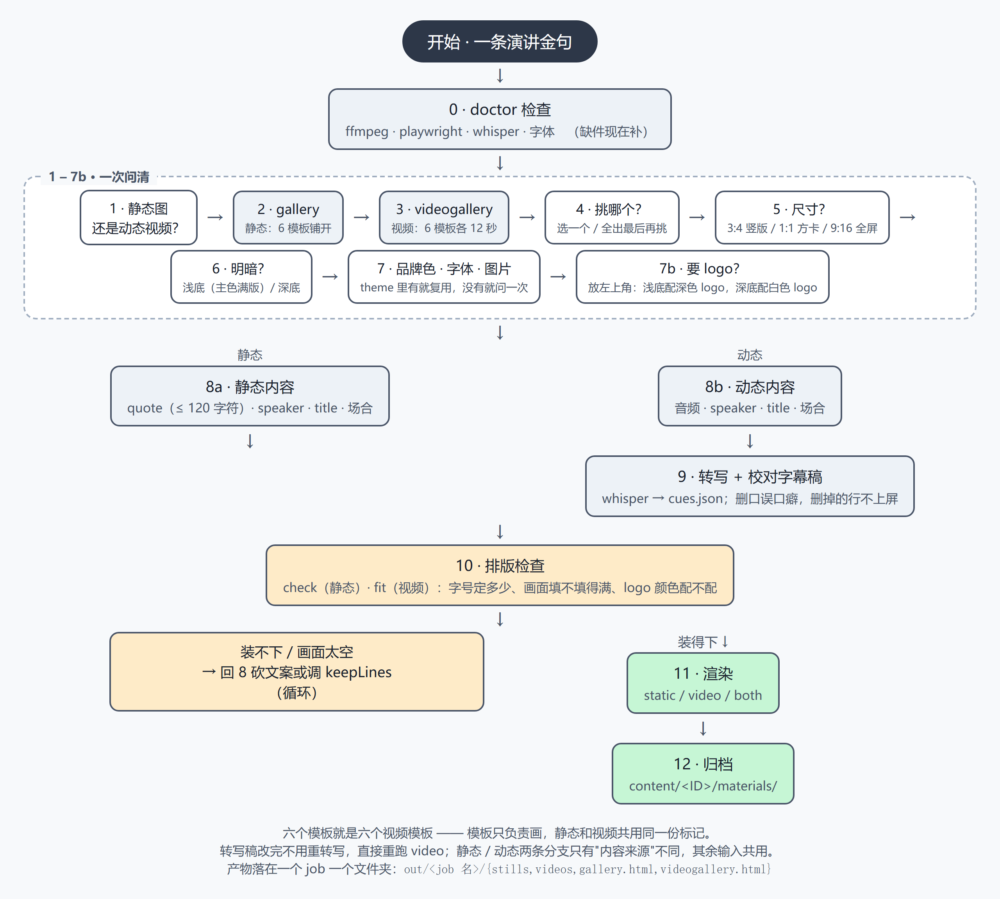

# quote-card 制作流程

一条演讲金句 → 一份 job 文件 → 静态图 + 卡准音频的竖版视频。



流程图源码在 [flow.html](flow.html)（浏览器直接能开），
改完跑 `python diagram.py` 重出 PNG。

> 这份流程不带任何人的品牌色。配色、字体、logo、图片都是"接进来"的一层，
> 换品牌只改 theme 文件，模板和流程一个字都不用动。

---

## 0 · 先看环境（不用问用户）

还没装依赖的话先看 [README 的安装一节](../README.md#如何安装) ——
Python 3.9+、`pip install pillow playwright faster-whisper`、
`playwright install chromium`，外加系统里的 ffmpeg。

装好了先自检：

```bash
python build.py doctor
```

```
  ok        ffmpeg   ...\ffmpeg.EXE
  ok        ffprobe  ...\ffprobe.EXE
  ok        playwright chromium 151.0.7922.34   (needed for every render)
  ok        faster-whisper 1.2.1   (needed for video)
  ok        pillow 12.3.0   (needed for every render)
  WARN      fonts/ has no font file   (themes fall back to the next family in the stack)
  static cards need only the browser. videos need ffmpeg + whisper.
```

**放第一步的理由**：静态图只要浏览器，视频要 ffmpeg + whisper。先查再问，
不会出现"聊到一半才发现缺件"。缺什么当场补，别让用户等。

> ⚠️ `fonts/` 空的时候，theme 里写的品牌字体其实没生效，会回退到字体栈的下一个。
> 字体文件丢进 [fonts/](../fonts/) 就自动生效，不用改 theme、不用改模板。

---

## 1 · 静态图 还是 动态视频？

一句话就能分家，后面的步骤只差一处：

| | 静态图 | 动态视频 |
|---|---|---|
| 内容来源 | 一句 quote | 一段音频（转成字幕） |
| 额外产物 | PNG | PNG + MP4 |
| 多花的工具 | 无 | whisper、ffmpeg |

**两条分支 90% 的输入是重合的**（说话人 / title / 场合 / 尺寸 / 明暗 / 配色都一样），
所以这些只问一次，两个分支共用。

---

## 2 · 静态长什么样：gallery 一次铺开

```bash
python build.py gallery jobs/<job>.json --ratios 1:1
```

出 `out/<job 名>/gallery.html`，浏览器打开就是六个模板并排：

| 模板 | 长相 | 适合 |
|---|---|---|
| `editorial` | 杂志排版，细线、小标签、破折号署名 | 权威、沉淀、发布会金句 |
| `boldblock` | 整块主色，引文反白出来 | 短句、锐评、态度强的观点 |
| `split` | 上色块引文 / 下素底署名 | 长引文，色块保证对比度 |
| `marker` | 关键词荧光笔 + 手写下划线，右对齐 | 最像"截图会想存"的社交卡 |
| `gradient` | 柔和网格渐变，实色字 | 想要"现代感"但不浮夸 |
| `photoframe` | 上传自己的图 + 遮罩压字 | 人物照、发布会现场图 |

**给用户两个选项，不逼他二选一**：

- 挑一个 → 把 job 里的 `template` 改成它的名字
- 全生成最后再挑 → `python build.py demo jobs/<job>.json`，六个全出

> gallery 用的是 **job 里那份 theme**。第 6 步挑完明暗之后，
> 选中的那一个模板会用新 theme 重出一遍 —— 第 11 步本来就要重出，不多花事。
> 想直接对照浅底 / 深底，就把 gallery 换另一个 theme 再跑一次。

**gallery 上已经能看出四件事**，跑完先看这四个：

- 右上角的大引号开没开（`showQuoteMark`）
- `split` 的主色占多大（`paneQuote`，默认 80%）
- 左上角的 logo 摆得对不对、深浅底版本对不对（`logo` / `logoOnDark`）
- 长句在哪个模板里开始挤

---

## 3 · 视频长什么样：videogallery 一次铺开

**六个静态模板，就是六个视频模板。** 没有第二套模板 —— 模板只负责画，
动效全在 `runtime.js` 里，静态和视频共用同一份标记、同一套 token。
视频不是"另一套模板"，是**同六个模板的一种播放模式**。

所以"哪个模板做视频好看"要单独看：

```bash
python build.py videogallery jobs/<job>.json --clip 12
```

出 `out/<job 名>/videogallery.html`，六个模板各一段 12 秒的同源片段，
**按播放键就能同时对照**（同一段音频的六次渲染，起点一样）。

- 默认 **3:4**（竖版但不夸张），`--ratios` 可以改
- `--clip 12` 是片段长度，`--start` 是从第几秒开始
- 片段短，六个一起出也就几分钟 —— 比渲完整一支再发现模板不合适便宜

---

## 4 · 挑哪个模板？

第 2 步的 gallery（静态）和第 3 步的 videogallery（视频）就是要挑的东西，
两个选项：

- **挑一个** → 把 job 里的 `template` 改成它的名字，比如 `"template": "marker"`
- **全生成最后再挑** → `python build.py demo jobs/<job>.json`，六个模板 × 尺寸全出，
  自己比完再定

挑不定就先按 `editorial` 走 —— 它最中性，改成别的只要换一个词。

---

## 5 · 尺寸

| 画幅 | 像素 | 备注 |
|---|---|---|
| `3:4` | 1080×1440 | **竖版默认**。1080 宽，比 9:16 矮一截，正好放一句话 |
| `1:1` | 1080×1080 | 方卡，小红书图文首图 |
| `9:16` | 1080×1920 | 全屏竖屏。卡片只有一句话时上下都是空的，除非平台要求 |

**竖版用 3:4，不用 9:16。** 9:16 是给"人站在画面里"的镜头留的高度，
一张只有引文的卡在 9:16 里上下各空一大截，字幕飘在中间像没做完。

**1:1 和 3:4 经常都要，直接一次出**：

```json
"ratio": ["1:1", "3:4"]
```

多尺寸时文件名自动带后缀（`<job>--1x1.png` / `<job>--3x4.png`）。
命令行也能临时改，`--ratios` 优先级最高。

> 视频画幅用 `video.ratios` 单独设，不跟静态图的 `ratio` 联动。
> 同一份 job 可以静态出 1:1、视频出 1:1 + 3:4。

---

## 6 · 明暗

**切 theme 文件，不动模板。** 同一套配色在不同明暗下是两套 theme：

| theme 类型 | 底 | 引文字色 | 什么时候用 |
|---|---|---|---|
| 浅底版 | 主色满版 | 深色 | 想要"品牌色铺满整张卡" |
| 浅底 · 白字版 | 主色满版 | 白色 + 投影 | 短句，白字靠投影从底色里浮出来 |
| 深底版 | 近黑 | 浅色，主色只做强调 | 长句、夜景、需要主色只点到为止 |
| 中性版 | 中性灰阶 | — | 还没定品牌时的占位 |

**浅底 + 白字要试过才知道行不行**：白字压在主色上常常只有 1.4:1 左右的对比度，
字是糊的。所以浅底版的默认是"深色字压主色"；想用白字，得给投影或者描边撑住。
渲染时会自动做对比度检查，低于阈值会打印警告 —— 别靠眼睛判断，按警告来。

> **第 7 步的 logo 版本跟着这一步走**：浅底 → 深色 logo，深底 → 白色 logo。

---

## 7 · 接自己的品牌：色 · 字 · 图

**这三样是可复用的，不该每次重问。**

- 品牌色 → 写进 `themes/<品牌>.json`
- 字体 → 丢进 `fonts/`，文件名里的家族名直接成为 CSS font-family
- 图片 → 写在 job 的 `tokens.bgImage`（`photoframe` / `marker` 用）

只有当 theme 里还没有这一套品牌色时才问一次，问完写进 theme 文件，
之后的每一条金句都直接复用。

**接品牌 = 改 token 值，模板一行都不用动**：

```json
{
  "bg": "#XXXXXX",          // 底色
  "ink": "#XXXXXX",         // 正文色
  "accent": "#XXXXXX",      // 强调色（高亮、进度条）
  "accent2": "#XXXXXX",     // 次强调色（荧光笔）
  "onPlate": "#XXXXXX",     // 压在引文面板上的字色
  "onField": "#XXXXXX",     // 直接落在底色上的字色（署名、标题、标签）
  "quoteFont": "Your Font, Arial, sans-serif"
}
```

同一个品牌的六个模板长得不一样，所以 theme 文件里可以给每个模板写覆盖：

```json
"overrides": {
  "boldblock": { "accent": "#XXXXXX" },
  "split":     { "bg2": "#XXXXXX" }
}
```

合并顺序：`DEFAULTS` < 主题 < 主题的 `overrides[模板]` < job 的 `tokens`。
job 里的 token 优先级最高，改单个模板不用重开一份主题。

完整 token 表见 [docs/REFERENCE.md](REFERENCE.md#配色token)。

---

## 7b · 要 logo（左上角）

**这一步要主动问，不能等着用户提。** 六张卡里没有品牌标识，跟有 logo 的差一截。

问的时候一次问全三件事：

1. **有没有 logo**（有就给文件：PNG，透明背景最好，横版字标最省事）
2. **浅底还是深底**（第 6 步已经定了）→ **浅底要黑色/深色 logo，深底要白色/浅色 logo**
3. **要不要两版**（同一批卡里既有浅底又有深底 —— 比如 `photoframe` 那张压着照片，
   照片偏深，就得配一版浅色 logo）

问完写进 job：

```json
"logo":       "../assets/my-logo-dark.png",    // 浅底用
"logoOnDark": "../assets/my-logo-white.png"    // 深底用
```

工具按**这张卡实际的地面**自动挑：模板压着照片（`photoframe`）就是深底，跟 theme 无关；
其他模板看 theme 的地面色 —— 深色 theme 要浅色 logo，浅色 theme 要深色 logo。
判断的不是"亮不亮"，是**哪个颜色在这个底上更跳**（亮橙 #FF4D2E 看着亮，
但配深色 logo 才看得清）。

**大小**：logo 占的是 `logoWidth` × `logoHeight` 的盒子（默认 240 × 84），字标按宽度走。
嫌小就写 `tokens.logoScale`：

```json
"tokens": { "logoScale": 1.5 }
```

一个数把盒子整体乘大。**别只改宽度不改它** —— 高度上限会把 logo 卡住，等于什么都没发生。
logo 变大会占掉引文区的空间，字号跟着缩，渲染前用 `fit` 量一下。

**logo 占的是 kicker 的位置**（左上角），给了 logo 就会把 kicker 顶掉 ——
一个角上放两套身份会打架。（logo 加载失败时 kicker 自动顶上，因为它只是被 CSS 藏着。）

第 10 步 `check` 会读 logo 的像素，算出它有多亮再跟底色比，**该换就直说**：

```
  logo: 浅底用 ../assets/my-logo-dark.png   颜色对得上底色
         另一版（深底用）：../assets/my-logo-white.png
```

底色和 logo 都太亮（或者都太暗）时会警告：`浅底配浅色 logo —— 换成黑色或深色 logo`。

---

## 8a · 静态图需要什么

| 要什么 | 例子 | 备注 |
|---|---|---|
| quote | `We're not building a smarter tool. We're redefining what work is.` | **字数有上限，见下** |
| speaker | `Alex Doe, Platform Engineer` | 卡片署名行 |
| title | `Engineering All-Hands 2026` | **场合 / 活动名就是这一个字段** |
| kicker | `KEYNOTE` | 可选，左上角小标签；给了 logo 会被顶掉 |
| logo | `../assets/my-logo-dark.png` | 可选，左上角 logo（第 7b 步） |
| showIndex | `false` | 可选，右上角的序号（`01`）默认显示 |
| showQuoteMark | `true` | 可选，右上角的大引号，默认不开 |
| highlight | `["never the interesting ones"]` | 只有 `marker` 模板用得上；**必须和文案里的字完全一致** |

**大引号和序号互斥**：两个都占右上角，同开就叠着。开大引号，序号自动让位。

**highlight 命中不了就等于没有荧光**：关键词必须和 `quote`（视频里是字幕）里的
一段文字完全一致。`check` 会报命中了几个、哪几个没命中。

**字数建议（英文，66px 基准字号实测）**

| 字符数 | 1:1 行数 | 竖版行数 | 观感 |
|---|---|---|---|
| 60 | 3 | 3 | 短句，最抓眼 |
| 100 | 4 | 4 | 可以 |
| 120 | 5 | 5 | 可以（**推荐上限**） |
| 140 | 5 | 6 | 竖版开始偏长 |
| 160 | 6 | 7 | 偏长 |
| 180 | 7 | 7 | 偏长 |
| 200 | 8 | 8 | 太长 |
| 240 | 8 | 10 | 太长 |
| 280 | 8（**字号缩到 63px**） | 12 | 1:1 到极限了 |
| 320 | 9（**字号缩到 60px**） | 13 | 竖版还没缩，但已经不像金句卡了 |

- **1:1 建议 ≤ 120 字符（5 行以内）**，竖版建议 ≤ 120 字符
- **中文一个汉字 ≈ 两个英文字符的宽度**，所以 1:1 的中文上限约 **60 字**
- 断词会差一行，实际以第 10 步 `check` 的测量为准
- 超了不要硬塞 —— 砍文案，或者 `tokens.quoteScale` 调小
- **左上角有 logo 会占掉一点引文区**（1:1 方卡尤其明显），字会小一档，
  第 10 步 `fit` 会量出来

---

## 8b · 动态视频需要什么

| 要什么 | 备注 |
|---|---|
| 音频 | `.m4a` / `.wav` / `.mp3` 都行 |
| speaker / title / 场合 | 和静态图完全一样 |
| logo | 和静态图完全一样（第 7b 步） |
| 起止时间 | 可选，`video.start` / `video.end` 掐头去尾 |
| 背景乐 | 可选，`music` + `musicGain`，自动压低 |
| 字幕显示方式 | `video.accumulate`：`true` = 念过的句子留在屏上（变淡），`false` = 一次只显示当前句 |
| 屏上留几句 | `video.keepLines`：累加模式下同时留在屏上的句数（当前句 + 前面几句），不写 = 全部 |
| 行距 | `video.density`：`compact` = 行距收紧，句多时用 |

**少一个字段**（不写 quote —— 视频里的文字从音频来）。

> **两种模式对模板的要求不一样**：`accumulate: true` 要把整段文字塞进一屏，
> 字号会被压得很小 —— 只有 `editorial` / `boldblock` 这类引文区能收缩的模板装得下。
> `accumulate: false` 每屏只有一句，字号能保持全大。
> 选 `split` / `marker` / `gradient` 之前，先按第 10 步量一下引文区高度。
>
> **想要"多句同屏"又不想字被压死**：用 `accumulate: true` + `keepLines: 3~4` ——
> 屏幕上留当前句加前面三四句，更早的滚出去。字号整支视频按最挤那一屏定死，
> 不会忽大忽小。开渲前先量一下（第 10 步 `fit`）：字号全程不变、画面又不空，
> 就是合适的值。

---

## 9 · 转写稿必须让用户过一遍

```bash
python build.py transcribe assets/speech.m4a -o assets/cues.json
python build.py cues jobs/<job>.json
```

```
    1    0.00  The hard problems were never the interesting ones.
    2    3.61  We built the boring part so you can build the interesting part.
    3    7.95  Good infrastructure is invisible until the moment it is missing.
```

**这一步不能省。** whisper 会把口误、重复、口癖（"那个"、"就是说"、嗯）一起写进去，
直接拿去渲染，字幕就会难看。

`cues.json` 就是一份普通 JSON，**让用户直接改**：

- 删掉一整行 → 这句字幕不上屏
- 把某一条的 `text` 清空成 `""` → 这条字幕不上屏（渲染时会自动跳过空行）
- 改字 → 字幕就改字
- 改 `start` / `end` → 字幕跟着挪

**改完不用重新转写**，直接 `video` 就行。转写只跑一次，字幕稿改到满意为止。

> 专有名词一定要人工改：whisper 不知道你们公司/产品怎么写。
> 改的时候顺便把要高亮的词加进 job 的 `highlight` ——
> **视频里的高亮词要在字幕里找得到**，静态图里则在 `quote` 里找。

---

## 10 · 排版检查（渲染前）

静态图用 `check`，视频用 `fit`。两个都不改文件，只报告。

```bash
python build.py check jobs/<job>.json       # 静态：这句话排得下吗
python build.py fit   jobs/<job>.json       # 视频：这支片子排得下吗
```

**`check`（静态）**

```
  quote: 65 chars, 65 units
  logo: 浅底用 ../assets/my-logo-dark.png   颜色对得上底色
         另一版（深底用）：../assets/my-logo-white.png
  荧光笔  命中 1/1：never the interesting ones
    1:1  66px, 3 lines   好 —— 短句，最抓眼
    3:4  66px, 3 lines   好 —— 短句，最抓眼
```

| 提示 | 意思 |
|---|---|
| `好 —— 短句，最抓眼` | 3 行以内，可以直接出 |
| `可以 —— 中等长度` | 4–5 行 |
| `偏长 —— 建议砍到 5 行以内` | 6–7 行 |
| `太长 —— 这已经是一段话，不是金句卡了` | 8 行以上 |
| `SHRUNK from 66px` | 字号已经被压过了，回去砍文案 |
| `logo: … 浅底配浅色 logo` | logo 版本选错了，换深色那一版 |
| `荧光笔 没命中（荧光笔不会出现在卡上）` | highlight 里的词和文案对不上 |

**`fit`（视频）**

```
  荧光笔  命中 3/3：all these platforms · all these models · all these APIs
  3:4 (1080×1440)   模板 split   主题 my-brand
  字号   基准 61px → 实际 61.4px（整支视频一次定死）
  窗口   屏上最多 4 句 / 全片 25 句
  最挤   高 703px   引文区 859px   余量 156px
  满窗   占引文区 55% ~ 82%，平均 69%
  开屏   第一句 160px（字幕本来就要一句一句堆）
  结论   装得下，字号全程不变，画面填得满 —— 可以开渲
```

`fit` 回答三件事：

| 数字 | 意思 | 不对劲的时候 |
|---|---|---|
| 实际字号 | 整支片子会用多大 | 比基准小很多 = 文案太长，被压扁了 |
| 最挤 / 余量 | 最满的一屏还剩多少空间 | 余量是负的 = 装不下，砍文案或调小 `keepLines` |
| 满窗占比 | 字幕堆满之后画面填不填 | 低于 45% = 画面空，字号偏小，加大 `quoteScale` 或多留几句 |

> 字号自动缩是不报错的 —— `fit` 和 `check` 存在的意义就是**在渲染前把这件事说出来**。

---

## 11 · 渲染

```bash
python build.py static jobs/<job>.json     # 只出图
python build.py video  jobs/<job>.json     # 只出视频
python build.py both   jobs/<job>.json     # 两个一起出
```

**产物落在 `out/<job 名>/`**，一个 job 一个文件夹：

```
out/<job 名>/
├── gallery.html        # 静态模板总览
├── videogallery.html   # 视频模板总览
├── stills/             # 静态图
└── videos/             # 视频
```

想先在浏览器里看效果再决定渲染：

```bash
python build.py static jobs/<job>.json --preview
```

会多写一个 `.html`，直接用浏览器打开，改 token 就能看，不用重跑渲染。

> 视频渲染是逐帧截图，慢但不会漂：每帧都是 `renderAt(t)` 的纯函数结果，
> `t` 直接来自音频时间轴。1080×1440 / 30fps 约 110ms 一帧，一支 70 秒的片子
> 约 4 分钟。**先 `fit`，再 `video`** —— 渲染完才发现字号不对，得再等 4 分钟。

---

## 12 · 归档

产物落在 `tools/quote-card/out/<job 名>/`。**用之前把最终选中的那几张复制到内容目录**：

```
content/<ID>/materials/          静态图
published/<条目>/media/          发布后的视频
```

（工作区约定：视频和封面产物不堆在根目录。）

---

## 相对你给的顺序，我改动了什么

| 改动 | 为什么 |
|---|---|
| **doctor 提到第 0 步** | 静态只要浏览器、视频要 ffmpeg + whisper。先查再问，别做到一半才发现缺件 |
| **品牌色/字体/图片改成"有就复用，没有才问"** | 这三样是可复用的，第二次就该直接读 theme，不该重问 |
| **theme 先于 gallery** | gallery 要用主题渲染。所以先读 `themes/` 里已有的品牌主题直接铺开，缺了才回头问 —— 不用为了看样式先问一轮配色 |
| **静态和动态合并成一次采集** | 两条分支 90% 输入重合，只有"内容来源"不同，不该问两遍 |
| **加了一步 videogallery** | 六个模板就是六个视频模板，但"哪个模板做视频好看"得看动效，静态图看不出来 |
| **竖版从 9:16 改成 3:4** | 一张只有一句话的卡，9:16 上下各空一大截；3:4 正好 |
| **加了第 7b 步要 logo** | 左上角是品牌位，logo 的深浅版本还得跟明暗对上一次。工具会读 logo 的像素自动检查配得对不对 |
| **加了第 10 步 check 和 fit** | 字号自动缩是不报错的，不提前查就只能在成图上发现 |
| **check 里加了荧光笔命中报告** | 关键词和文案对不上，荧光笔就是不会出现 —— 看着像工具坏了，其实是词写错了 |
| **photoframe 永远有一张图** | 这模板本来就是"放你自己的图"，空框是 bug 不是风格 |
| **加了"转写稿改完不用重转写"** | whisper 慢，字幕稿要来回改好几轮，重新转写是浪费 |
| **加了字数表** | 写之前就知道上限，不用渲染完才发现塞不下 |
| **流程里不带品牌色** | 这套流程要能给别人用，配色是接进来的一层，不是流程的一部分 |
| **产物按 job 分文件夹** | 一个文件夹几十个同名文件的时候，"哪个文件对应哪条"要靠猜 |

---

## 附：一条金句的完整命令序列

```bash
# 0. 环境
python build.py doctor

# 2. 看静态样式（六个模板铺开）
python build.py gallery jobs/example.json --ratios 1:1

# 3. 看视频样式（六个模板各一段 12 秒）
python build.py videogallery jobs/example.json --clip 12

# 10. 排版检查（logo 颜色、荧光笔命中、字号）
python build.py check jobs/example.json
python build.py fit   jobs/example.json

# 11. 出图
python build.py static jobs/example.json

# 9. 视频（先转写 → 让用户改 cues.json → 再渲染）
python build.py transcribe assets/speech.mp3 -o assets/speech_cues.json
python build.py cues jobs/example.json
python build.py video jobs/example.json
```
